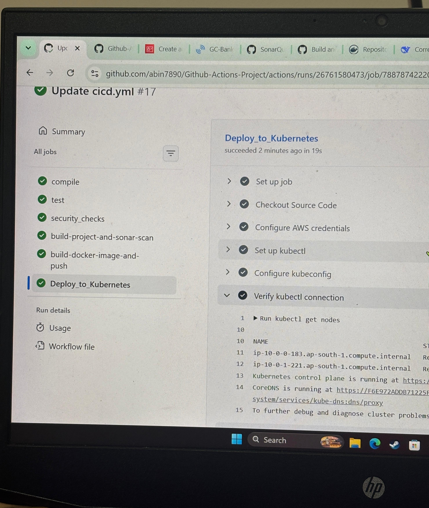
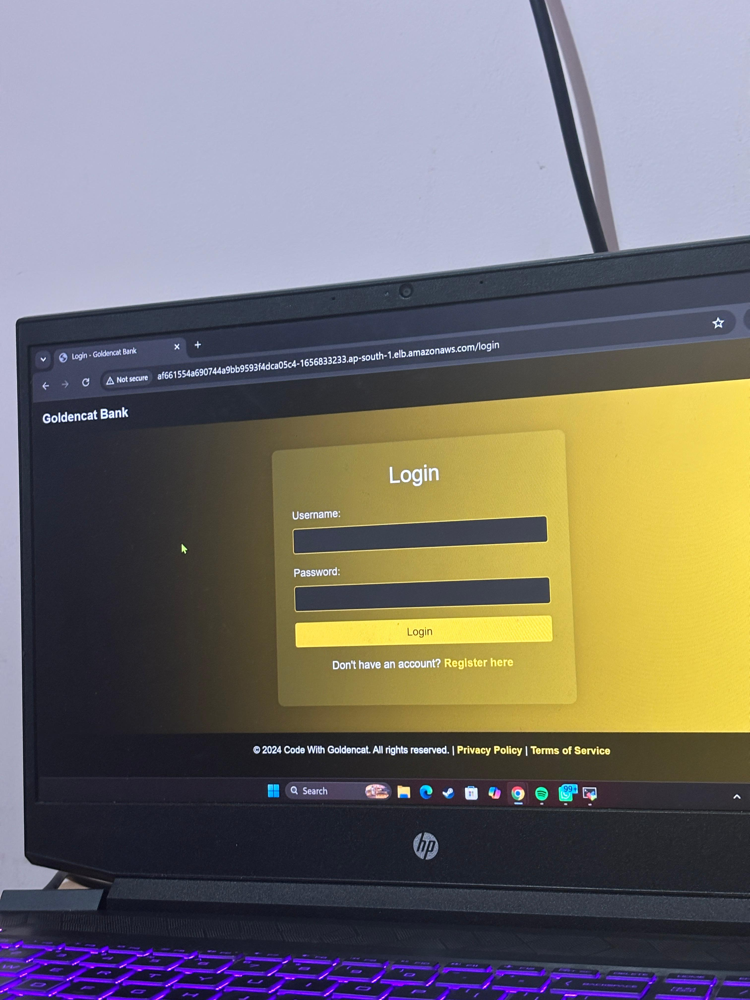

# GitHub-Actions-End-to-End-DevSecOps-Pipeline
End-to-end DevSecOps CI/CD pipeline using GitHub Actions, Terraform, Docker, SonarQube, Trivy, Gitleaks, and Kubernetes on AWS EKS.  

### Automated | Secure | Scalable | Infrastructure as Code

An end-to-end DevSecOps project demonstrating automated CI/CD, security scanning, code quality analysis, Docker containerization, and Kubernetes deployment on Amazon EKS using GitHub Actions and Terraform.

<h2 align="center">🏗️ Project Architecture</h2>

  

## Project Overview

This project demonstrates the implementation of a DevSecOps CI/CD pipeline for a Java application.

The pipeline integrates continuous integration, automated testing, security scanning, code quality analysis, containerization, and deployment to Kubernetes.

Terraform is used to provision AWS infrastructure, including the Amazon EKS cluster.

## Technologies Used

| Technology | Purpose |
|---|---|
| GitHub | Source code management |
| GitHub Actions | CI/CD automation |
| Java 17 | Application runtime |
| Maven | Build and unit testing |
| SonarQube | Static code analysis |
| Trivy | Vulnerability scanning |
| Gitleaks | Secret detection |
| Docker | Application containerization |
| Docker Hub | Container image registry |
| Terraform | Infrastructure as Code |
| Amazon EKS | Kubernetes cluster |
| Kubernetes | Container orchestration |

## CI/CD Pipeline Workflow

### Stage 1: Source Code Management
- Application source code is maintained in GitHub.
- Changes pushed to the main branch trigger the CI/CD workflow.

### Stage 2: Build
- Configure Java JDK 17.
- Compile the Java application using Maven.

### Stage 3: Unit Testing
- Execute automated unit tests using Maven.
- Validate the application before proceeding to deployment.

### Stage 4: Security Scanning
- Perform filesystem vulnerability scanning using Trivy.
- Detect exposed secrets using Gitleaks.

### Stage 5: Code Quality Analysis
- Package the Java application using Maven.
- Run SonarQube static code analysis.
- Evaluate the SonarQube Quality Gate.

### Stage 6: Docker Image Build and Push
- Build the application Docker image.
- Tag the Docker image.
- Push the image to Docker Hub.

### Stage 7: Kubernetes Deployment
- Provision the Amazon EKS cluster using Terraform.
- Deploy the containerized application to Kubernetes.
- Run the application using Kubernetes workloads.

## Infrastructure as Code

Terraform is used to manage AWS infrastructure.

The infrastructure setup includes provisioning the Amazon EKS cluster required to host the application.

Using Infrastructure as Code helps make infrastructure configuration reproducible and easier to maintain.

## DevSecOps Practices

The pipeline incorporates security and quality checks into the application delivery process.

**Security Scanning**
- Trivy for vulnerability detection.
- Gitleaks for identifying accidentally exposed secrets.

**Code Quality**
- SonarQube for static code analysis.
- Quality Gate evaluation.

**CI/CD Automation**
- GitHub Actions for workflow orchestration.
- Automated build, test, scan, and deployment stages.

## Project Screenshots

<!-- GitHub Actions CI/CD Pipeline -->

<h2 align="center">🚀 GitHub Actions CI/CD Pipeline</h2>

  

  <i>
    Automated DevSecOps CI/CD pipeline using GitHub Actions
    for building, testing, security scanning,
    Docker image creation, and deployment to AWS EKS.
  </i>

<!-- Deployed Application UI -->

<h2 align="center">🌐 Deployed Application UI</h2>

  

  <i>
    Application successfully deployed on Amazon EKS
    using an automated GitHub Actions DevSecOps CI/CD pipeline.
  </i>

### Architecture Diagram

  

## Key Learning Outcomes

- Designing an end-to-end DevSecOps pipeline.
- Implementing CI/CD workflows using GitHub Actions.
- Integrating automated security scanning.
- Performing code quality analysis using SonarQube.
- Building and publishing Docker images.
- Provisioning cloud infrastructure using Terraform.
- Deploying containerized applications to Amazon EKS.
- Understanding the integration between CI/CD, Infrastructure as Code, and Kubernetes.

## Conclusion

This project demonstrates how modern DevOps and DevSecOps tools can be integrated to automate the application delivery lifecycle, from source code changes to deployment on Amazon EKS.

It provides practical experience with CI/CD automation, security scanning, containerization, Infrastructure as Code, and Kubernetes.
